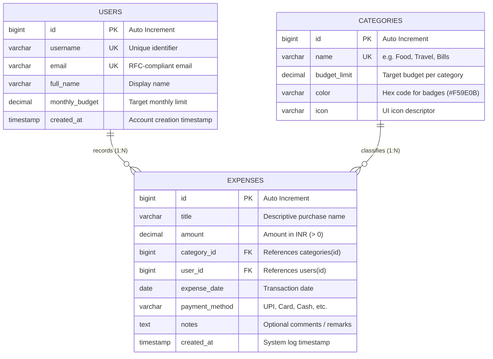

# Entity-Relationship (ER) Diagram & Schema Specification

**Project Title**: SpendWise - Expense Tracker Web Application  
**Subject**: Full Stack Java Laboratory (`CE-JWP-LAB`) | **Scheme**: `DB25-V1`  
**Target RDBMS**: MySQL 8.x / 26.x (with JPA/Hibernate ORM Mapping)

---

## 1. Visual Entity-Relationship (ER) Diagram

---

## 2. Table Data Dictionaries

### A. `users` Table
| Column Name | SQL Type | Constraints | Description |
| :--- | :--- | :--- | :--- |
| `id` | `BIGINT` | `PRIMARY KEY, AUTO_INCREMENT` | Unique identifier for each user |
| `username` | `VARCHAR(50)` | `NOT NULL, UNIQUE` | Unique handle used for session/login |
| `email` | `VARCHAR(100)` | `NOT NULL, UNIQUE` | User's verified email address |
| `full_name` | `VARCHAR(100)` | `NULLABLE` | Display name for greetings and reports |
| `monthly_budget`| `DECIMAL(12, 2)`| `DEFAULT 25000.00, CHECK >= 0` | Configured monthly expenditure ceiling |
| `created_at` | `TIMESTAMP` | `DEFAULT CURRENT_TIMESTAMP` | Account creation audit timestamp |

### B. `categories` Table
| Column Name | SQL Type | Constraints | Description |
| :--- | :--- | :--- | :--- |
| `id` | `BIGINT` | `PRIMARY KEY, AUTO_INCREMENT` | Unique category identifier |
| `name` | `VARCHAR(100)` | `NOT NULL, UNIQUE` | Name of expenditure group (e.g., Food, Travel) |
| `budget_limit`| `DECIMAL(12, 2)`| `DEFAULT 5000.00, CHECK >= 0` | Threshold limit for category notifications |
| `color` | `VARCHAR(20)` | `DEFAULT '#3B82F6'` | Hex color code used for charts and badges |
| `icon` | `VARCHAR(50)` | `DEFAULT 'Folder'` | Descriptive icon keyword |

### C. `expenses` Table
| Column Name | SQL Type | Constraints | Description |
| :--- | :--- | :--- | :--- |
| `id` | `BIGINT` | `PRIMARY KEY, AUTO_INCREMENT` | Unique expense transaction identifier |
| `title` | `VARCHAR(150)` | `NOT NULL` | Description of item purchased |
| `amount` | `DECIMAL(12, 2)`| `NOT NULL, CHECK > 0` | Monetary cost of transaction |
| `category_id` | `BIGINT` | `NOT NULL, FOREIGN KEY` | Linked category reference (`RESTRICT` on delete) |
| `user_id` | `BIGINT` | `NULLABLE, FOREIGN KEY` | Linked owner (`SET NULL` on delete) |
| `expense_date` | `DATE` | `NOT NULL` | The calendar date of the expenditure |
| `payment_method`| `VARCHAR(50)`| `DEFAULT 'UPI'` | Method of settlement (UPI, Card, Cash) |
| `notes` | `TEXT` | `NULLABLE` | Free-form notes / invoice references |
| `created_at` | `TIMESTAMP` | `DEFAULT CURRENT_TIMESTAMP` | Timestamp when entry was submitted |

---

## 3. Relationships & Referential Integrity
1. **User to Expenses (1-to-Many)**: One user can log multiple expenses. Deleting a user sets `user_id` to NULL to retain historical financial data.
2. **Category to Expenses (1-to-Many)**: One category classifies multiple expense transactions. Deleting a category that contains active expenses is restricted to prevent orphan records.
3. **Indexes**:
   - `idx_expenses_date` on `expense_date DESC` ensures rapid retrieval for monthly dashboards.
   - `idx_expenses_category` accelerates category aggregations (`GROUP BY category_id`).
