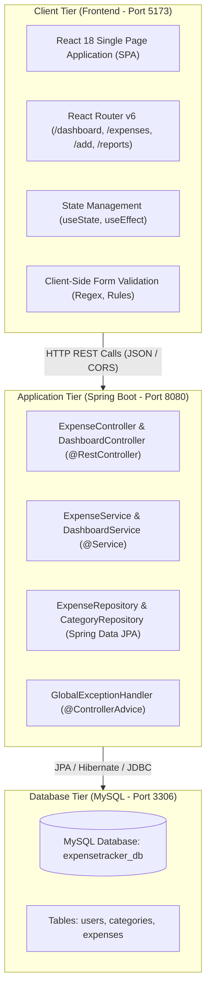
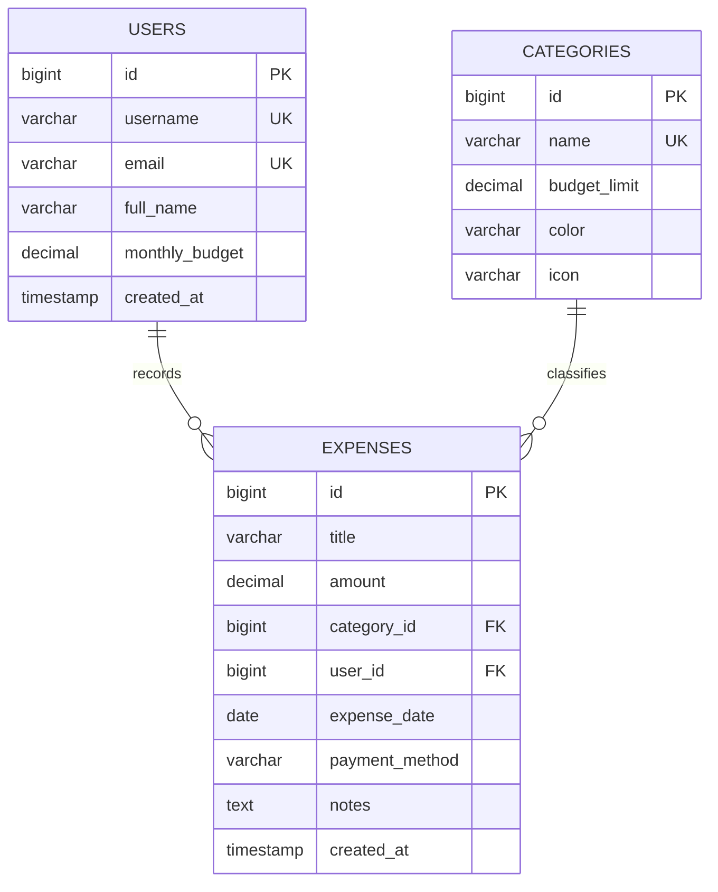

# Full Stack Java Mini Project Report
## Expense Tracker Web Application ("SpendWise")

**Academic Year**: 2026 – 27  
**Department**: Computer Engineering | Semester III  
**Subject Code**: `CE-JWP-LAB` | **Scheme**: `DB25-V1`  

---

### Course Outcome (CO) Mapping & Bloom's Taxonomy
| CO | Bloom's Level | Course Outcome Statement | Contribution in Project |
| :--- | :--- | :--- | :--- |
| **CO3** | **L3 – Apply** | Implement Java-based programs and integrate client-side and server-side components to build functional applications. | Seamless integration between React frontend (fetch/proxy) and Spring Boot REST backend. |
| **CO4** | **L4 – Analyze** | Analyze Java programs to identify and fix runtime errors using exception handling and multithreading mechanisms. | `@ControllerAdvice` global exception handling, validation checking, and CORS debugging. |
| **CO5** | **L5 – Evaluate** | Assess the efficiency, scalability, and maintainability of Java full stack applications and suggest improvements. | Evaluated layered monolithic architecture vs microservices, query indexing, and state management. |
| **CO6** | **L6 – Create** | Design and develop complete full stack solutions using Java, databases, front-end frameworks, and Spring Boot. | Complete end-to-end Expense Tracker application with MySQL persistence and React UI. |

---

## 1. Problem Statement & Objectives

### Problem Statement
Personal finance management is often disorganized when individuals rely on manual notebooks or ad-hoc messaging logs. Individuals struggle to monitor where their money goes across categories (food, transportation, bills, shopping) and frequently overshoot monthly spending budgets without warning.

### Project Objectives
1. Provide an intuitive, real-time web application to track daily income and expenditures.
2. Deliver a responsive Single Page Application (SPA) using **React 18** with client-side routing and instant reactive state updates.
3. Design a robust, decoupled **Spring Boot 3** REST API following industry-standard **Controller–Service–Repository–Entity** layered architecture.
4. Persist data reliably in **MySQL 8.x / 26.x** with referential integrity, indexes, and custom JPA aggregate queries.
5. Provide automatic budget alerts, category-wise spending distribution charts, and CSV data export for financial auditing.

---

## 2. System Architecture

The application adopts a decoupled multi-tier full-stack architecture:



### Layered Architecture Breakdown (Experiment 12)
1. **Entity Layer (`model`)**: Encapsulates data schema using JPA annotations (`@Entity`, `@Table`, `@Id`, `@GeneratedValue`, `@ManyToOne`). Employs Jakarta Validation (`@NotBlank`, `@Positive`, `@NotNull`).
2. **Repository Layer (`repository`)**: Extends `JpaRepository<T, ID>`, providing boilerplate-free CRUD and custom JPQL aggregate queries for category breakdowns.
3. **Service Layer (`service`)**: Encapsulates business logic, transactional boundaries (`@Transactional`), budget utilization calculations, and filter logic.
4. **Controller Layer (`controller`)**: Exposes RESTful JSON endpoints (`@GetMapping`, `@PostMapping`, `@PutMapping`, `@DeleteMapping`) with `@CrossOrigin` support.
5. **Exception Layer (`exception`)**: Centralized error interceptor (`@RestControllerAdvice`) delivering uniform HTTP 400, 404, and 500 JSON error objects.

---

## 3. Database Schema & ER Design

### Entity Relationship Model


---

## 4. REST API Specification

| Endpoint | HTTP Method | Request Body | Response Code | Description |
| :--- | :--- | :--- | :--- | :--- |
| `/api/expenses` | `GET` | None (Optional Query Params: `search`, `categoryId`, `startDate`, `endDate`) | `200 OK` | Fetch all expenses or filtered records |
| `/api/expenses/{id}` | `GET` | None | `200 OK` / `404 Not Found` | Retrieve single expense by ID |
| `/api/expenses` | `POST` | `ExpenseRequestDto` (JSON) | `201 Created` / `400 Bad Request` | Create a new expense entry |
| `/api/expenses/{id}` | `PUT` | `ExpenseRequestDto` (JSON) | `200 OK` / `404 Not Found` | Update an existing expense |
| `/api/expenses/{id}` | `DELETE`| None | `204 No Content` / `404 Not Found`| Delete expense record |
| `/api/categories` | `GET` | None | `200 OK` | Fetch all category master records |
| `/api/dashboard/stats` | `GET` | None | `200 OK` | Fetch computed financial overview metrics |
| `/api/user/budget` | `PUT` | `{"monthlyBudget": 35000.0}` | `200 OK` / `400 Bad Request` | Update user's monthly spending limit |

---

## 5. Front-End Component Hierarchy (React SPA)

```
App.jsx (BrowserRouter)
├── Navbar.jsx (Sticky header with route links and dynamic branding)
└── main.main-content
    ├── Routes
    │   ├── Route path="/" -> DashboardPage.jsx
    │   │   ├── SummaryCards (Spent, Remaining, Budget, Total Count)
    │   │   ├── BudgetProgressBar (Visual color-coded threshold alert)
    │   │   ├── SpendingByCategory (Percentage breakdown progress bars)
    │   │   └── RecentTransactionsTable (Quick actions: Edit, Delete)
    │   │
    │   ├── Route path="/expenses" -> ExpensesPage.jsx
    │   │   ├── FilterBar (Instant search, category dropdown, date range)
    │   │   ├── SortDropdown (Date, Amount)
    │   │   ├── FullDataTable (Formatted Indian Rupee currency)
    │   │   └── CSVExportButton (Browser-side data download)
    │   │
    │   ├── Route path="/add" -> ExpenseFormPage.jsx
    │   │   └── Validated Expense Form (Regex title check, positive amount)
    │   │
    │   ├── Route path="/edit/:id" -> ExpenseFormPage.jsx
    │   │   └── Preloaded form for updating an existing record
    │   │
    │   └── Route path="/reports" -> ReportsPage.jsx
    │       ├── Category share distribution table
    │       ├── Payment method volume analysis
    │       └── Lab observation and testing verification table
    │
    └── Footer.jsx (Course details & technical credits)
```

---

## 6. Verification & Test Cases

| Test Case ID | Feature / Layer | Input Data / Action | Expected Result | Actual Result | Status |
| :--- | :--- | :--- | :--- | :--- | :--- |
| **TC-01** | Backend CRUD | `POST /api/expenses` with valid fields | HTTP 201 Created; auto-generated ID returned | ID generated, record saved | **PASS** |
| **TC-02** | Validation | `POST /api/expenses` with `amount: -100` | HTTP 400 Bad Request; field error message | Rejected with validation details | **PASS** |
| **TC-03** | Exception Handling| `GET /api/expenses/99999` | HTTP 404 Not Found with clean JSON response | Structured error payload | **PASS** |
| **TC-04** | Client Routing | Click 'All Expenses' in Navbar | URL changes to `/expenses`, view swaps with 0 reload | Instant React Router swap | **PASS** |
| **TC-05** | Budget Alert | Monthly expense exceeds 80% / 100% | Warning / Danger banner renders on Dashboard | Color-coded alert displayed | **PASS** |
| **TC-06** | Search & Filter | Enter keyword in filter bar | Table filters to matching titles/notes dynamically | Filtered results displayed | **PASS** |
| **TC-07** | CSV Data Export | Click 'Export CSV' button | Browser triggers download of `Expense_Report.csv` | File generated and saved | **PASS** |

---

## 7. Conclusion & Future Enhancements

The **SpendWise Expense Tracker** successfully fulfills all requirements outlined in the *DBIT Full Stack Java Laboratory Manual*. By integrating a decoupled React SPA with a layered Spring Boot REST backend and MySQL database, the project exemplifies contemporary enterprise software design practices:
- **Loose Coupling**: Frontend and backend communicate exclusively via JSON over REST.
- **Single Source of Truth**: MySQL provides relational integrity with constraints and indexes.
- **Extensible Architecture**: Clean service and controller separation simplifies future feature additions.

### Future Enhancements
1. **Authentication**: Implement JWT (JSON Web Tokens) or Spring Security OAuth2 for multi-user isolation.
2. **Containerization**: Package backend and frontend into multi-stage Docker containers with Docker Compose.
3. **Automated Testing**: Implement unit tests using JUnit 5 and Mockito for services, and React Testing Library for frontend components.
